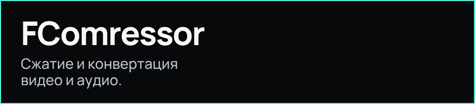

Android-приложение для сжатия и конвертации видео и аудио через FFmpeg. Пользователь выбирает файл и режим обработки, а приложение показывает прогресс и сохраняет результат в выбранную папку.

## Возможности

- Режимы с целевым размером, автоматическими параметрами, ручными настройками и обработкой аудио.
- Анализ входного файла через Android MediaMetadataRetriever и расчёт битрейта.
- Обработка через Android Foreground Service и локальная история задач в Room.

## Сборка

Для сборки нужны JDK 17 и Android SDK Platform 35. Для запуска подойдёт устройство или эмулятор с Android 8.0 (API 26) либо новее. Откройте корень проекта в Android Studio и синхронизируйте Gradle. Debug APK можно собрать из IDE или из командной строки.

```powershell
.\gradlew.bat assembleDebug
```

```sh
sh ./gradlew assembleDebug
```

Результат находится в `app/build/outputs/apk/debug/`.

### Подключение FFmpeg

Для обработки медиа добавьте исполняемую сборку FFmpeg для Android и ABI устройства перед сборкой APK. Например, для `arm64-v8a` используйте следующий путь.

```text
app/src/main/jniLibs/arm64-v8a/libffmpeg.so
```

При запуске обработки приложение ищет `libffmpeg.so` в каталоге нативных библиотек. Набор доступных кодеков зависит от сборки. Для `libx264` нужна сборка FFmpeg с этим энкодером, а для аппаратного режима H.264 нужны `h264_mediacodec` и поддержка на устройстве. Условия распространения сборок и сторонних компонентов описаны в документации проекта. [Лицензирование FFmpeg](https://ffmpeg.org/legal.html)

## Устройство проекта

| Компонент | За что отвечает |
| --- | --- |
| `ui/` | Экраны Jetpack Compose и параметры обработки |
| `domain/` | Режимы работы, параметры кодирования и расчёт битрейта |
| `data/ffmpeg/` | Поиск бинарников, аргументы и запуск процесса |
| `data/db/` | История задач в Room |
| `service/` | Очередь и обработка в Foreground Service |
